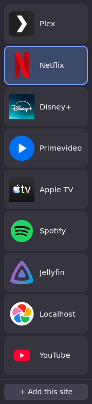
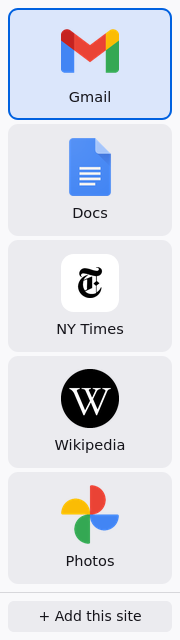
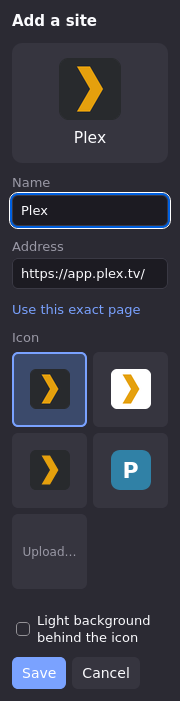

# Siderail

A Firefox add-on that shows your chosen sites as big buttons in the sidebar. Clicking a button loads that site in the current tab, so one window and one tab can move between sites like channels on a TV.

- One column of buttons that share the sidebar's height: a handful of sites get large buttons with the icon above the name, and many sites shrink to compact rows.
- Large icons only. Small favicons look blurry on a big button, so Siderail finds a site's large icons (its web app manifest, Apple touch icon, SVG icon), or the app's icon from [dashboard-icons](https://github.com/homarr-labs/dashboard-icons), or you upload one, or it shows a coloured letter.
- The button for the site in the current tab is highlighted.

Install it from [addons.mozilla.org](https://addons.mozilla.org/firefox/addon/siderail/) (the first version, 0.1.0, is in Mozilla's review).

It started as a launcher for a living-room PC, but nothing in it is TV-specific: it works just as well as a simple console for someone who only needs a few sites.

<p>
  
  &nbsp;
  
  &nbsp;
  
</p>

## Using it

- **Add a site:** open it, then press **+ Add this site** at the bottom of the sidebar. Siderail suggests a name, a home address and the best icon it found; change any of them, then **Save**.
- **Open a site:** click its button to load it in the current tab. Ctrl-, Shift- or middle-click opens it in a new tab.
- **Edit, reorder or remove:** right-click a button. Reorder one step at a time, or straight to the top or bottom. **Undo** under the buttons brings back a site you removed by mistake.
- **Icons:** in the editor, pick any of the icons found, the letter, **Upload…**, or **Search…** to find one in [dashboard-icons](https://github.com/homarr-labs/dashboard-icons) by the app's name (it starts from the site's name; arrow keys and Enter work too). That matters most for self-hosted apps, which often have no large icon of their own: when the site's name or host is exactly the name of an app there (Jellyfin, `sonarr.home.lan`), its icon is offered by itself, after any icons the site has. You can also paste or drop an image onto the editor. **Light background behind the icon** puts a white square behind dark logos; Siderail ticks it automatically for mostly-black icons on transparency.
- **Back up or move your list:** Siderail's options (in `about:addons`, or **Import a backup** in the empty sidebar) export your list to a file, icons included, and import one back. Importing adds to your list; a site you already have is replaced, not duplicated.
  [`docs/example-export.json`](docs/example-export.json) is an example: four streaming sites, two with PNG icons and two (Netflix, Disney+) with SVGs from dashboard-icons.

### Permissions

- **Tabs:** to read the current tab's address (for the highlight and for adding sites) and to load sites into it.
- **Storage:** your list of sites, kept on this computer.
- **Access your data for all websites** (optional, asked the first time you add a site): only used to download the page you're adding and its icons, to find a large icon and its name. Without it you can still add sites with an icon from dashboard-icons, an uploaded icon or a letter.

Icons are stored inside the add-on as images (PNG, or SVG when the icon is one), not links, so the sidebar works offline and sites can't see when it's shown.

The editor gets dashboard-icons from jsDelivr (`cdn.jsdelivr.net`), which needs no permission: the list of icons once while the sidebar is open (searching it happens in the add-on, so what you type isn't sent), the search results' pictures, and the icon you pick or the one that matches the site you're adding. It reads the repository's main branch, so new apps show up without a new Siderail, once jsDelivr's cache catches up.

## Development

You need Node 22.2 or later, Firefox 142 or later, geckodriver and [just](https://just.systems). `just` finds Firefox on your `PATH`; set `FIREFOX_BIN` to use a different one (on macOS, `/Applications/Firefox.app/Contents/MacOS/firefox`).

```sh
just setup      # install the npm tools (web-ext, selenium)
just            # list recipes
just dev        # Firefox with the add-on loaded; your test sites persist in .dev-profile/
just test       # unit tests
just e2e        # end-to-end tests in headless Firefox
just check      # lint + unit + e2e
just build      # dist/siderail.xpi (unsigned)
just screenshots  # regenerate the README screenshots
```

Firefox loads unsigned add-ons temporarily (`just dev`, or `about:debugging`), so signing only matters for a permanent install.

GitHub Actions runs `just check` on every pull request and push to `main` (`.github/workflows/check.yml`), using the Firefox and geckodriver that come with its Ubuntu runner.

### Layout

- `extension/manifest.json`: Manifest V3, Firefox 142+.
- `extension/sidebar/`: the sidebar page. `sidebar.js` is the UI: the button list, the right-click menu, the editor and icon discovery, which needs the browser.
- `extension/options/`: the options page, with export and import.
- `extension/storage.js`: loading and saving the list, shared by both pages. `theme.css` is their shared colours and buttons.
- `extension/lib/`: pure logic with no browser APIs, all unit-tested:
  - `match.js`: which saved site a tab address belongs to (same host, longest path prefix; or the only site on that host, so a site saved at a deep page still lights up elsewhere on it).
  - `icons.js`: collecting icon candidates from `<link>` tags and the manifest, then ranking them. Icons under 64px are dropped. Every icon is stored at 192px, so anything 180px or over counts as equally sharp and the kind of icon decides: plain over maskable, then manifest, Apple touch icon, other `<link>` icons.
  - `names.js`: suggesting a name (manifest, then meta tags, then the page title, then the host) and a home address.
  - `sites.js`: list operations (add or replace, remove, move a step or to a position, merge an import).
  - `backup.js`: the backup file, and checking an imported one: icons must be PNG or SVG data, addresses http or https.
  - `letter.js`, `plate.js`: the letter fallback and the "needs a light background" check.
  - `dashboard.js`: searching dashboard-icons' list (names first, then aliases, which are often categories), guessing a site's icon only from an exact name, and where to download each icon.

### Tests

- `test/unit/`: `node --test` against `extension/lib/`.
- `test/e2e/`: Selenium and geckodriver drive the built add-on in headless Firefox against two local fixture sites (`fixtures.js`). One has a manifest and an Apple touch icon; the other has only a 16px favicon, a deep page, and a page that sends the add-on's own request to a sign-in page on the other site. Two more pages are self-hosted apps, one with an icon of its own and one without, and the same server has a small copy of dashboard-icons, which the tests point the add-on at through `dashboardIconsBase` in its storage. They cover adding sites, the icon ranking, the letter fallback, uploading a dark logo, the highlight (including for a site saved at a deep page), opening a site here or in a new tab, editing, reordering, removing and undoing, not asking for access on pages that aren't websites, exporting the list and importing it back from the options page, and dashboard-icons: the icon guessed for an app, searching (variants, aliases, a PNG when the SVG is missing, the keyboard) without access to sites, and when it can't be reached. They run in order in one browser, each starting from the sites the previous ones left.
  - WebDriver can't reach the real sidebar panel, so the tests open the same page in a tab. There, buttons load into the tab used before it (`targetTab()` in `sidebar.js`).
  - Firefox won't let WebDriver navigate a tab to an extension page, so the test opens it from Firefox's privileged context, which needs geckodriver's `--allow-system-access`.
  - A pref pins the add-on's internal UUID, so its page has a known address.

### Screenshots

`just screenshots` regenerates `docs/screenshot-*.png` from `docs/screenshots.json`, so change that file rather than editing the images. `just screenshots editor` redoes only the shots whose file name contains "editor".

- **What's in them:** the scene file has named site lists (`tv`, `family`) and the shots: which list, the size and theme, the page open in the current tab (its button is highlighted) and, for the editor, the site being added.
- **Icons** come from [dashboard-icons](https://github.com/homarr-labs/dashboard-icons) by name (`"plex"`), or any URL (NY Times is from [selfh.st/icons](https://github.com/selfhst/icons)), pinned to a commit so the images only change when the scene does. Generating them needs internet access for the icons only.
- **How:** `scripts/screenshots.js` reuses the e2e setup (`test/e2e/browser.js`) and sends all of Firefox's traffic through a local proxy that serves a stand-in page for each site, so no real site is visited. Each stand-in's manifest offers the scene's icon, and every site is added through the real **+ Add this site** editor, so icon sizing and the light background are decided by the add-on itself. HSTS preloading and https upgrades are turned off for this.
- Output is byte-identical between runs on the same machine; fonts come from the system, so another machine may differ slightly.

### Releasing

Siderail is published as a listed add-on on addons.mozilla.org (AMO), which signs it and updates it in everyone's Firefox.

1. `just release 1.2.3 "What changed"` sets the version in `extension/manifest.json` (the only place it's kept), runs `just check`, commits, and tags `v1.2.3` with the notes as the tag's message. It pushes nothing.
2. `git push origin main v1.2.3`. The `release` workflow (`.github/workflows/release.yml`) checks the tag matches the manifest, runs `just check` again, submits the version to AMO for review (`just amo-submit`), and makes a GitHub release with the notes and the unsigned build.
3. Mozilla reviews it, usually within a few days, then signs and publishes it.

- **The listing text** (summary, description, category, licence, links) is in `release/amo-metadata.json` and is sent with every version, so change it there, not on the AMO website. A unit test checks it against AMO's rules.
- **Credentials:** the workflow needs the repository secrets `AMO_API_KEY` and `AMO_API_SECRET`, the JWT issuer and secret from [AMO's API keys page](https://addons.mozilla.org/developers/addon/api/key/). The keys belong to your AMO account, so one pair works for all your add-ons; AMO keeps only one pair active, so regenerating it breaks the old one everywhere. `just amo-secrets` asks for them, checks them with AMO and sets both secrets, so nothing is mistyped or carries pasted whitespace. `just amo-check` checks the keys in `WEB_EXT_API_KEY` and `WEB_EXT_API_SECRET` (`scripts/amo-credentials.js`, which submits nothing), and the workflow runs it first so a bad key fails in seconds. To submit from your own machine, set those two and run `just amo-submit "notes"`.
- **Versions** are plain `major.minor.patch`. AMO refuses a version number it has seen before, even from a failed submission, so a retry needs a new number.

## Design decisions

These were settled while designing it. Revisit them only with a reason.

- **The sidebar, not tabs.** Firefox's own vertical tabs were the obvious alternative. But every site stays loaded (and keeps playing audio in the background), and the icons are small. Siderail keeps one page and swaps what's in it.
- **One column.** A wider sidebar makes bigger buttons, not more columns.
- **Large icons or nothing.** Scaled-up 16px favicons were mocked up and rejected as too blurry. The fallback is a letter tile, never a favicon.
- **SVG icons stay SVG; others become 192px PNGs.** 192px covers the largest button (about 83 CSS pixels) on a 2× screen, but a TV scaled to 3× needs more, and SVGs are sharp at any size. SVGs over 100 KB (usually an embedded photo) become PNGs too, and one with a width and height but no `viewBox` gets one, so it scales.
- **Reorder from the right-click menu, not by dragging.** The list is set up once and rarely changed, so drag to reorder isn't worth its edge cases (telling clicks from drags, links dragging out of the sidebar, flaky WebDriver tests). The menu also works from the keyboard. See [#1](https://github.com/jonocodes/siderail/issues/1).
- **No custom layouts.** Letting users supply their own HTML, or load a dashboard site into the sidebar with its links redirected into the main tab, was considered and dropped.
- **Firefox only.** Chrome's side panel can't reopen by itself when the browser starts, which defeats a launcher that should always be there. Chrome also only installs extensions automatically through machine-wide policy.
- **Signing through addons.mozilla.org.** Release Firefox only installs signed add-ons permanently. Building Firefox with signing turned off, or using Developer Edition, was rejected.
- **Parked alternatives.** If signing or installation becomes the blocker:
  - A Tampermonkey userscript avoids signing, but has to draw over every page, fights site layouts, and doesn't run on Firefox's own pages.
  - Firefox AutoConfig (a privileged startup script) could add a real panel without an add-on, but suits a single managed machine only.

## Not done yet

- Syncing the list between computers (Firefox Sync's add-on storage is too small for icons, so it would sync the list and re-fetch icons).
- An admin-set list through Firefox's policy file (managed storage), for kiosk and family machines.

## License

[GPL-3.0-only](LICENSE).
